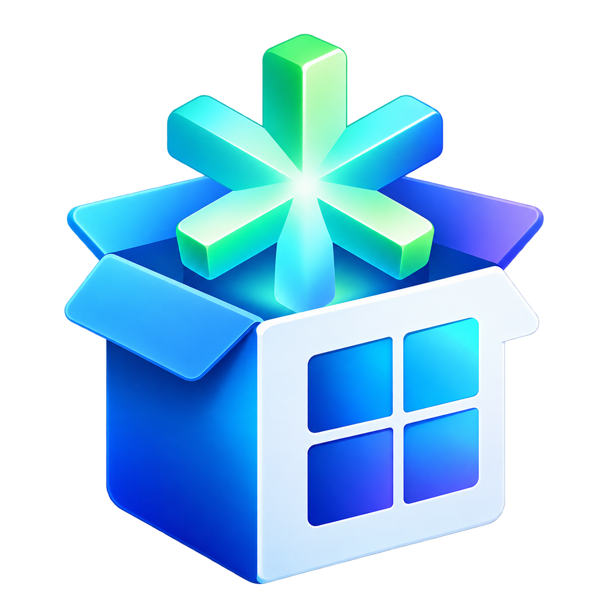

# FreshBox | فرش‌باکس



[آخرین نسخه برای ویندوز · Latest Windows release](https://github.com/Lastsaman/FreshBox/releases/latest)

## فارسی

بعد از نصب ویندوز، معمولاً اولین کار این است که مرورگر، پیام‌رسان، ابزار فشرده‌سازی، پخش‌کننده و چند برنامه‌ی ضروری دیگر را دوباره پیدا و نصب کنیم. FreshBox برای کوتاه‌کردن همین مسیر ساخته شده است.

برنامه را باز کن، مواردی را که لازم داری تیک بزن و نصب را شروع کن. FreshBox از WinGet استفاده می‌کند تا هر برنامه را با شناسه‌ی مشخص و از منبع ثبت‌شده‌ی خودش بگیرد. فهرست فعلی ۱۴۵ برنامه دارد و هیچ موردی از اول انتخاب نشده است.

در نسخه‌ی جدید، وقتی چند برنامه را با هم نصب می‌کنی، دو دانلود/نصب هم‌زمان انجام می‌شود تا زمان انتظار کمتر شود. اگر یک دانلود موقتاً شکست بخورد، FreshBox یک بار دیگر تلاش می‌کند. پیشرفت هر برنامه، پیام WinGet و نتیجه‌ی نهایی در پنجره‌ی وضعیت دیده می‌شود و گزارش متنی اجرا هم در پوشه‌ی لاگ برنامه ذخیره می‌شود.

عمداً WinGet را دور نمی‌زنیم و لینک‌ها را با یک دانلودکننده‌ی ناشناس جایگزین نمی‌کنیم. WinGet قبل از در اختیار گذاشتن فایل، هش مانیفست را بررسی می‌کند و برنامه‌های Microsoft Store هم مسیر مخصوص خودشان را دارند. چندپارتی‌کردن خامِ لینک‌ها می‌تواند این کنترل‌ها یا نصب Store را خراب کند؛ بنابراین سرعت را با صف هم‌زمان، تلاش مجدد و حفظ بررسی رسمی بالا برده‌ایم.

### اجرا

- **Setup:** فایل Setup را دانلود و اجرا کن؛ محل نصب را خودت انتخاب می‌کنی.
- **Portable:** فایل ZIP را کامل استخراج کن و `FreshBox.exe` را اجرا کن. فایل‌های DLL و پوشه‌ی `resources` باید کنار EXE باقی بمانند.

پیش‌نیازها: Windows 10 یا 11 نسخه‌ی ۶۴ بیتی، اینترنت و WinGet (App Installer). بعضی برنامه‌ها از Microsoft Store می‌آیند و برای آن‌ها دسترسی Store لازم است. درخواست‌های UAC و پیام‌های امنیتی ویندوز عمداً تحت کنترل خود کاربر باقی می‌مانند.

مسیر پیش‌فرض نصب `C:\Program Files` است. اگر می‌خواهی برنامه‌ها روی درایو دیگری نصب شوند، مسیر را قبل از شروع انتخاب کن؛ پشتیبانی از مسیر سفارشی به قابلیت همان نصاب بستگی دارد.

## English

After a fresh Windows install, the same routine starts again: find a browser, a messenger, an archive tool, a media player, and a handful of everyday apps. FreshBox is a small, focused way to get through that routine faster.

Open the app, select what you need, and start the setup. FreshBox uses WinGet, with an explicit package ID and source for every entry. The current catalogue contains 145 apps, and nothing is selected by default.

When several apps are selected, the current build runs two WinGet jobs at a time instead of making every item wait for the previous one. A temporary download failure gets one retry. The window shows per-app progress, WinGet output, and the final result; a text log is also kept in the app data folder.

FreshBox deliberately keeps WinGet in charge of downloading and installing. WinGet verifies installer hashes from package manifests, and Microsoft Store packages follow a different delivery path. A blind multi-part downloader could bypass those checks or break Store installs, so FreshBox improves throughput with a small concurrent queue and safe retries rather than replacing the trusted installer path.

### Running it

- **Setup:** download and run the Setup executable. The installer lets you choose where FreshBox itself is installed.
- **Portable:** extract the complete ZIP archive and run `FreshBox.exe`. Keep its DLL files and the `resources` folder beside it.

Requirements: 64-bit Windows 10 or 11, an internet connection, and WinGet (App Installer). Store packages may require Microsoft Store access. UAC and Windows security prompts remain visible and user-controlled.

The default application location is `C:\Program Files`. You can choose another base folder before starting; the final installer decides whether a custom location is supported.

## Development / توسعه

```powershell
npm ci
npm start
npm test
npm run audit:catalog
node tools/smoke-ui.js
npm run build:all
```

Electron و JavaScript ساده؛ کاتالوگ در `reviewed-catalog.js` است و فایل‌های موقت بیلد در `release-source` قرار می‌گیرند. گزارش‌های بررسی در `reports` نگه‌داری می‌شوند.

This is an Electron app written in plain JavaScript. The catalogue lives in `reviewed-catalog.js`; build staging uses `release-source`, and audit reports are kept under `reports`.

## What has been checked / چه چیزهایی بررسی شده

All 145 package identities have been checked against WinGet. The current audit has 144 direct installer entries and one Microsoft Store entry. Seven-Zip and SumatraPDF were downloaded completely and hash-checked; no installer is executed by the audit. Every catalogue item has a local WebP icon. This does not promise that every installer will behave identically on every Windows machine.

شناسه‌ی هر ۱۴۵ برنامه با WinGet بررسی شده است: ۱۴۴ مورد لینک مستقیم نصاب و یک مورد Microsoft Store دارند. دانلود کامل و بررسی هش برای نمونه‌های 7-Zip و SumatraPDF انجام شده و در مرحله‌ی بررسی هیچ نصابی اجرا نمی‌شود. همه‌ی برنامه‌ها آیکون WebP محلی دارند؛ با این حال رفتار نصاب‌ها روی همه‌ی سیستم‌ها یکسان تضمین نمی‌شود.

Created by [lastsaman](https://t.me/LASTsaman) · ساخته‌شده توسط lastsaman
